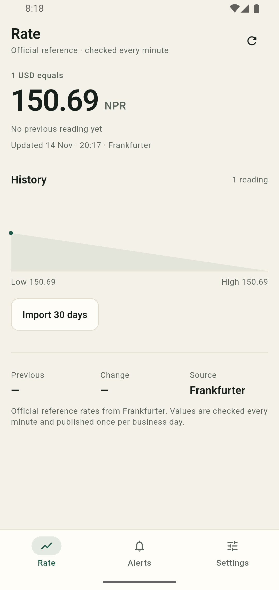
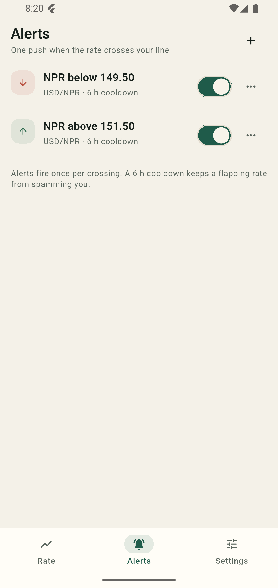
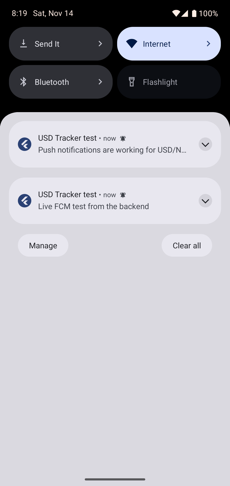

# USD Tracker

A USD/NPR exchange-rate tracker with a **lightweight Express + TypeScript +
Drizzle** backend and a **Flutter Android** client.

- **Backend** (`backend/`) — Express 5 on Bun. Fetches
  [Frankfurter](https://frankfurter.dev) rates on demand, stores changes in
  Turso/libSQL via Drizzle ORM, evaluates threshold alerts and sends Firebase Cloud
  Messaging pushes. **No in-process cron**: an external scheduler calls a secured
  endpoint every minute.
- **App** (`app/`) — Flutter 3.50 client on `material_ui`, with Bloc + Dio +
  GoRouter + Freezed + Hive CE + `get_it` and a forest-green / warm-bone design
  system.

## Screens

| Rate | Alerts |
| --- | --- |
|  |  |



## Quick start

```bash
# 1. Backend
cd backend
bun install
cp .env.example .env          # set API_KEY, CRON_SECRET, Firebase base64
bun run dev                   # http://localhost:3000/api/v1

# 2. Trigger the poll the external scheduler would call
curl -X POST -H "x-cron-secret: $CRON_SECRET" \
  http://localhost:3000/api/v1/cron/rates

# 3. Android app (uses the deployed backend by default)
cd app
flutter pub get
flutter run --dart-define=API_KEY=<deployed-api-key>

# Local backend instead:
# flutter run --dart-define=API_BASE_URL=http://10.0.2.2:3000/api/v1
```

- App default API: <https://usd-tracker-mauve.vercel.app/api/v1>
- Local API: <http://localhost:3000/api/v1>

Without `API_BASE_URL` the app uses the deployed backend. On a physical device
against a local backend, pass your machine's LAN IP.

## External cron

The API does not schedule anything itself. The scheduler calls:

```http
GET or POST /api/v1/cron/rates
X-Cron-Secret: <CRON_SECRET>
```

and once a day:

```http
POST /api/v1/cron/maintenance
```

Any HTTP cron service works. On Vercel **Hobby**, use
[cron-job.org](https://cron-job.org/en/) because Vercel only allows daily Cron
Jobs on that plan:

- `POST https://<project>.vercel.app/api/v1/cron/rates` every 1 minute
- `POST https://<project>.vercel.app/api/v1/cron/maintenance` daily at 03:15
- Header `X-Cron-Secret: <CRON_SECRET>` on both

The endpoint returns `502` on provider failure and `status: skipped` if a previous
poll is still running.

## How it works

```
External cron ──► POST /api/v1/cron/rates
                       │
                       ▼
              Fetch Frankfurter v2
                       │
              store changed rate (Drizzle + Turso/libSQL)
                       │
              evaluate threshold rules
                       │
              FCM multicast to registered devices
```

The web process can sleep between requests; state lives in Turso/libSQL. Locally
the default is a libSQL file; Vercel uses a Turso Cloud database over HTTPS.

## API

```
GET    /api/v1/health
GET    /api/v1/rates
GET    /api/v1/rates/:quote
GET    /api/v1/rates/:quote/history?limit=100
POST   /api/v1/rates/refresh                 X-API-Key
POST   /api/v1/rates/:quote/backfill?days=30  X-API-Key
GET    /api/v1/cron/rates                    X-Cron-Secret
POST   /api/v1/cron/rates                    X-Cron-Secret
GET    /api/v1/cron/maintenance              X-Cron-Secret
POST   /api/v1/cron/maintenance              X-Cron-Secret
POST   /api/v1/devices                       X-API-Key
GET    /api/v1/devices                       X-API-Key
DELETE /api/v1/devices/:token                X-API-Key
GET    /api/v1/alerts                        X-API-Key
POST   /api/v1/alerts                        X-API-Key
PATCH  /api/v1/alerts/:id                    X-API-Key
DELETE /api/v1/alerts/:id                    X-API-Key
GET    /api/v1/notifications?limit=50        X-API-Key
POST   /api/v1/notifications/test            X-API-Key
```

Alerts are edge-triggered with a cooldown. They are currently **global**, not
per device/user; see the backend README.

## Configuration

- Backend: [`backend/.env.example`](backend/.env.example) — database, API key,
  `CRON_SECRET`, quotes, Firebase credential, notification behaviour.
- App: build-time defines documented in [`app/README.md`](app/README.md).

## Firebase

1. Create a Firebase project and register the Android package
   `np.com.abhishekd.usdTracker`.
2. Put the client config at `app/android/app/google-services.json`.
3. Backend: use a service account JSON, locally via
   `FIREBASE_SERVICE_ACCOUNT_PATH` or deployed as
   `FIREBASE_SERVICE_ACCOUNT_BASE64` (sensitive).
4. In the app: **Settings → Enable notifications**; test with
   `POST /api/v1/notifications/test`.

Full details: [`docs/flutter-integration.md`](docs/flutter-integration.md).

## Tests

```bash
# Backend: 11 unit + 7 e2e
cd backend
bun test
bun run test:e2e

# App: analyzer, 18 tests, design-token guard
cd app
flutter analyze
flutter test
bash scripts/check_design_tokens.sh lib
```

## Layout

```
backend/
  src/
    app.ts / server.ts
    config/env.ts
    db/{schema,database,app-state}.ts
    features/{rates,alerts,devices,notifications,health,cron,maintenance}/
    shared/{errors,http,logger}.ts
  api/index.ts             Vercel function entrypoint
  vercel.json              rewrites + cron schedule
  drizzle/                 CLI-generated migrations
  test/                    unit + e2e
app/
  lib/{app,core,features}
  vendor/reactive_forms/   pinned fork for material_ui
  test/
docs/
  flutter-integration.md
```

## Requirements

- Bun **1.3+** locally; Node 20+ on Vercel
- Flutter **3.50** / Dart 3.14 and Android SDK with API 37
- Turso Cloud database for Vercel (local `file:` DB otherwise)
- Firebase project for real push (optional for development)

## Notes

- **External scheduler is required.** Nothing polls on startup; call
  `/api/v1/cron/rates` every minute.
- Frankfurter publishes official **daily** rates; minute polling catches new
  publications quickly but is not intraday tick data.
- Turso is remote, so Vercel has no filesystem dependency. The poll's overlap
  guard is still per instance; use a DB lock if you expect concurrent invocations.
- Vercel Hobby does not allow per-minute Cron Jobs; cron-job.org handles the schedule.
- Alerts are global; per-device criteria (`brother wants < 140 NPR`) needs the
  alert-ownership schema change described in the backend README.
- The app is built on Flutter 3.50's `material_ui` package. `reactive_forms`
  upstream still targets the deprecated SDK Material library, so it is vendored
  under `app/vendor/reactive_forms` with its imports migrated.
