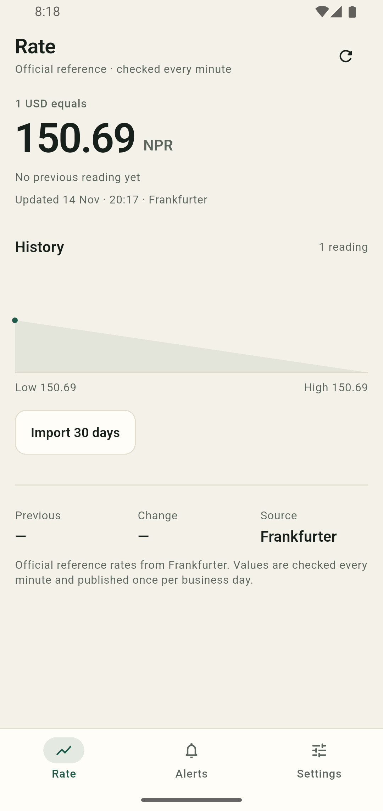
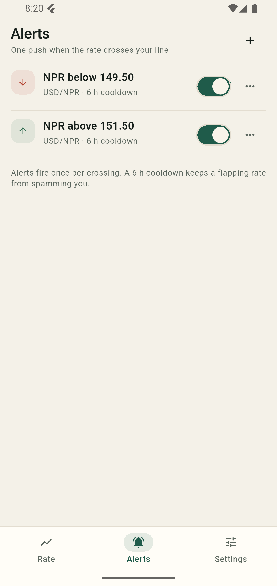
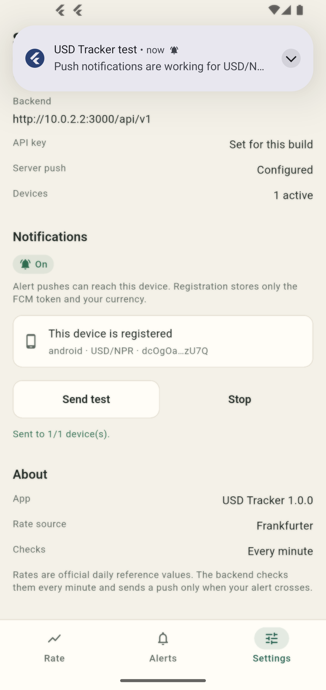
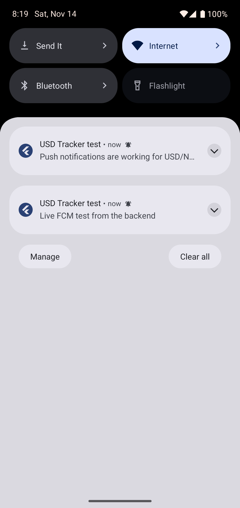

# USD Tracker — Flutter app (Android)

The Android client for the [USD Tracker backend](../backend). It shows the
current USD/NPR reference rate, its history, threshold alerts, and device push
status.

Built with the project's standard stack:

| Concern | Choice |
| --- | --- |
| State | `flutter_bloc` — Cubits, route-scoped |
| Network | Dio, one shared instance with an API-key interceptor |
| Models | Freezed + `json_serializable` |
| Navigation | GoRouter (`StatefulShellRoute`) |
| Forms | `reactive_forms` (create-alert form) |
| Cache | Hive CE (JSON snapshots, offline fallback) |
| DI | `get_it` |
| Push | Firebase Cloud Messaging + local notifications |

## Run

```bash
cd app
flutter pub get

# Android emulator (backend on the same machine)
flutter run \
  --dart-define=API_BASE_URL=http://10.0.2.2:3000/api/v1 \
  --dart-define=API_KEY=dev-secret
```

With no `API_BASE_URL`, the app uses the Android emulator host `10.0.2.2`.
On a physical device pass your computer's LAN IP (or a deployed HTTPS URL).
`API_KEY` is optional; it must match the backend's `API_KEY` for registering
devices and managing alerts.

| Define | Default | Meaning |
| --- | --- | --- |
| `APP_ENV` | `dev` | `prod` requires an explicit `API_BASE_URL` |
| `API_BASE_URL` | `http://10.0.2.2:3000/api/v1` | Full base URL including `/api/v1` |
| `API_KEY` | empty | Sent as `X-API-Key` on every request |
| `QUOTE` | `NPR` | Currency the dashboard/alerts default to |
| `INITIAL_ROUTE` | `/rates` | Demo/debug only: open a tab directly |
| `OPEN_ALERT_FORM` | `false` | Demo/debug only: start Alerts with the form open |

Start the backend with `cd ../backend && bun run dev`. The API has no internal
scheduler, so trigger a poll with `POST /api/v1/cron/rates` (or point your cron
service at it) before expecting fresh rates.

## Screens

| Rate | Alerts |
| --- | --- |
|  |  |
| Settings | Push |
|  |  |

- **Rate** — hero USD/NPR value, direction pill, last update, sparkline,
  low/high, previous/change/source, pull-to-refresh, “Import 7 days” when
  history is thin. Failures keep existing data on screen and surface as a
  snackbar; first load has a content-shaped skeleton.
- **Alerts** — edge-triggered threshold rules. Toggle a rule, delete with an
  inline confirmation, create via the form page. Empty, loading, error and
  populated states are all designed.
- **Settings** — backend health (DB, FCM, devices, last poll), API-key status,
  push permission state, device registration, test push, and app/rate-source
  information.

## Architecture

```
lib/
├─ main.dart / bootstrap.dart
├─ app/
│  ├─ app.dart                 MaterialApp.router + themes
│  ├─ di/service_locator.dart  get_it
│  └─ router/                  GoRouter, shell, routes
├─ core/
│  ├─ theme/                   palette, type, spacing, radius, motion, theme
│  ├─ widgets/                 App* widgets (button, scaffold, states, fields…)
│  ├─ errors/                  Failure, Result, runCatchingExceptions
│  ├─ network/                 Dio client + interceptors
│  ├─ services/                Firebase push abstraction
│  ├─ storage/                 Hive keys
│  └─ utils/                   logger, formatters
└─ features/
   ├─ rates/{data,repo,bloc,ui}
   ├─ alerts/{data,repo,bloc,ui}
   └─ settings/{data,repo,bloc,ui}
```

Dependency direction is one-way: `UI → Cubit → Repo → DataSource → Dio/Hive`.
Repos return `Result<T>`; exceptions are mapped only in `runCatchingExceptions`.
No Cubit knows another Cubit. `AlertsCubit` reads tracked quotes through
`RatesRepo`, not through `RatesCubit`.

### State

`RatesState` and `AlertsState` are single Freezed classes with a `ViewStatus`
and retained data; refreshing never wipes the screen. Lists are normalised to
`ids` + `byId` so a toggle rebuilds only its row (there is a rebuild-count test).
One-shot effects (snackbars) go through `BlocListener` with `listenWhen`.

### Design system

Forest green (`#1F5B4A`) on warm bone (`#F4F1E8`), with a proper dark palette.
All colour, type, spacing, radius and motion values live in `core/theme/**`;
features read them through `context.palette`, `context.text`, `AppSpacing`,
`AppRadius`, `AppSizes` and `AppMotion`. Custom `App*` widgets replace stock
Material chrome. `bash scripts/check_design_tokens.sh lib` enforces this.

## Push notifications

Push is wired end-to-end but **optional at runtime**. With no Firebase project
files the app still runs; Settings shows “Push is unavailable in this build” and
the rate/alert features keep working.

To enable it:

1. Create a Firebase project with Cloud Messaging enabled and register the
   Android package `np.com.abhishekd.usdTracker`.
2. From `app/`:
   ```bash
   dart pub global activate flutterfire_cli
   flutterfire configure
   ```
   This writes `lib/firebase_options.dart` and
   `android/app/google-services.json`.
3. Configure the backend service account (see `backend/README.md`).
4. Run the app, open **Settings → Enable notifications**, allow permission, then
   **Send test**.

The app calls `Firebase.initializeApp()` with native defaults rather than
importing the generated `firebase_options.dart`, so the project builds without a
Firebase account. If you prefer explicit options, pass
`DefaultFirebaseOptions.currentPlatform` in `FirebasePushService`.

The Android channel is `usd_rates`; it matches the backend's
`FCM_ANDROID_CHANNEL_ID`. Foreground messages are shown through
`flutter_local_notifications`.

> `firebase_messaging` 17 deprecates `getToken()` in favour of Firebase
> Installation IDs (`register()` / `onRegistered`). The app still uses
> `getToken()` because the backend uses `firebase-admin`
> `sendEachForMulticast`, which targets FCM registration tokens. Revisit both
> sides together if you migrate to FID targeting.

## API key on mobile

An API key embedded with `--dart-define` is extractable. For a public release,
either leave the backend's `API_KEY` empty for device registration or put the
API behind an API gateway / Firebase App Check. The key is useful for personal
builds and internal testing.

## Tests and checks

```bash
flutter analyze
flutter test
bash scripts/check_design_tokens.sh lib
dart format lib test
```

18 tests cover failure mapping, rates/alerts Cubits (load, retention, create,
toggle), alert form validation, the inline form flow and a row-level
rebuild-isolation test.

## Notes

- **Material UI**: Flutter 3.50 moves Material into the `material_ui` package,
  which this app uses. `reactive_forms` 18 still imports the deprecated SDK
  Material library, so it is vendored at `vendor/reactive_forms` with its 24
  Material imports migrated. Remove the path dependency once upstream supports
  `material_ui`; do not `pub upgrade` it blindly.
- **Android**: `compileSdk = 37` (Firebase/AndroidX requirement) and core-library
  desugaring (for `flutter_local_notifications`). `path_provider_android` is
  pinned to `2.2.23` because the 2.3.x line pulls `jni_flutter`, whose Android
  plugin still compiles against API 35.
- Rates are official daily reference values from Frankfurter; the backend checks
  every minute but the value changes roughly once per business day.
- The SQLite/Hive cache is network-first: on a failed fetch the last snapshot is
  shown with a “Cached” pill.
- The app expects the backend's `GET /rates` and `/rates/:quote/history`
  response shapes; no other transport.
